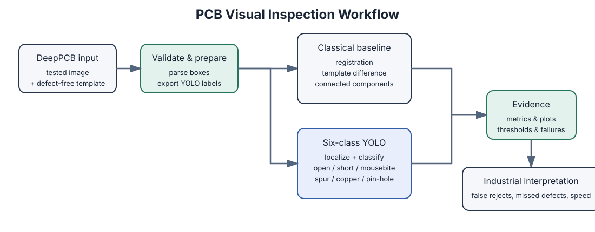

# PCB Visual Inspection

This project develops a reproducible, template-based visual inspection pipeline
for PCB manufacturing defects. It is intended as a portfolio project aligned
with industrial optical inspection and Visual AI work.

## First milestone

The initial implementation provides:

- A typed representation of DeepPCB samples and bounding-box annotations.
- Strict parsing and validation for the repository's
  `x1,y1,x2,y2,type` annotation format and the whitespace-separated format
  used by the downloaded repository.
- Dataset discovery that pairs `_test.jpg`, `_temp.jpg`, and `.txt` files.
- A command-line summary for checking a local dataset before training.
- A class-agnostic template-difference baseline with connected-component
  extraction and IoU-based precision, recall, and F1 evaluation.
- Small-translation registration and global brightness/contrast normalization
  options for reducing camera and fixture variation.
- Annotated image and JSON inspection reports for demonstrating results.
- YOLO-format export for the six-class detector training milestone.

DeepPCB contains paired defect-free template and tested images with six defect
classes: `open`, `short`, `mousebite`, `spur`, `copper`, and `pin-hole`.
The dataset is available from
<https://github.com/tangsanli5201/DeepPCB> and is intended for research use.

### Workflow



## Setup

From this directory:

```bash
python3 -m venv .venv
source .venv/bin/activate
python -m ensurepip --upgrade
python -m pip install --upgrade pip setuptools
python -m pip install -e '.[dev]'
```

The pip upgrade is important on older macOS Command Line Tools Python
installations: pip versions before editable PEP 660 support cannot install a
`pyproject.toml` project with `-e`.

Install the optional training backend only when you are ready to train:

```bash
python -m pip install -e '.[ai]'
```

Run the tests:

```bash
python -m pytest
```

## Inspect a downloaded dataset

After downloading and extracting DeepPCB, run:

```bash
pcb-inspect summary /path/to/DeepPCB
```

The command does not load image pixels. It checks file pairing and annotation
structure so dataset problems are found before a model is trained.
It supports both annotations next to the images and the DeepPCB repository
layout, where annotations are stored in sibling directories ending in
`_not`. When the repository root is supplied, utility example images under
`tools/` are excluded automatically by scanning `PCBData/`.

## Run the classical baseline

```bash
pcb-inspect baseline /path/to/DeepPCB --threshold 30 --min-area 4
```

The baseline compares each grayscale test image with its template, thresholds
the absolute difference, groups changed pixels into connected components, and
matches candidate boxes to annotations at IoU 0.33. It is deliberately
class-agnostic: it measures localization quality and provides a reference
against which a later six-class model can be compared.

Use `--limit 10` for a quick smoke test on the first ten samples.

For images with small fixture or camera shifts, enable registration and
illumination normalization:

```bash
pcb-inspect baseline /path/to/DeepPCB --register --normalize --max-shift 5
```

## Create inspection reports

Generate an annotated PNG and a JSON report for each sample:

```bash
pcb-inspect report /path/to/DeepPCB ./reports \
  --limit 10 \
  --register \
  --normalize
```

The JSON report records the preprocessing configuration, detected boxes,
localization metrics, and a `passed` decision. The current decision is strict:
it passes only when every annotation is matched and no extra region is found.

## Prepare six-class detector data

Export the tested images and zero-based YOLO labels:

```bash
pcb-inspect prepare /path/to/DeepPCB ./prepared-data
```

The command creates `images/train`, `images/val`, `labels/train`,
`labels/val`, and `dataset.yaml`. It uses the tested image as the detector
input and keeps the template image separate for the classical reference
pipeline. Samples are sorted deterministically and split by the
`--validation-ratio` (20% by default). Keep the official DeepPCB evaluation
set separate when making final benchmark claims.

## Train the six-class detector

After preparing the data and installing the optional AI dependency:

```bash
pcb-inspect train ./prepared-data/dataset.yaml ./runs \
  --model yolo11n.pt \
  --epochs 50 \
  --image-size 640 \
  --batch-size 16
```

Training fails explicitly if the prepared dataset is incomplete or the optional
Ultralytics dependency is not installed. The default run is reproducible with
seed `42`; change it deliberately when comparing experiments.

## Evaluate a trained detector

After training finishes, evaluate the best checkpoint on the validation split:

```bash
pcb-inspect evaluate \
  ./runs/detect/runs/pcb-defect-detector-2/weights/best.pt \
  ./prepared-data/dataset.yaml \
  ./evaluation-results
```

This writes `metrics.json` and Ultralytics validation plots under the output
directory. The report includes the checkpoint, dataset, image size, batch size,
and metric values such as precision, recall, mAP@0.5, and mAP@0.5:0.95.

## Analyze detector errors

Use the saved COCO-format predictions to produce per-class metrics and a
confusion matrix:

```bash
pcb-inspect analyze \
  ./prepared-data \
  ./runs/detect/evaluation-results/validation/predictions.json \
  ./error-analysis
```

The command writes `error-analysis.json` and `per-class-metrics.csv`. Matching
uses one-to-one box assignment at IoU 0.5 and a confidence threshold of 0.25
by default. Adjust both thresholds explicitly when studying production
trade-offs, especially for `short` recall and `pin-hole` precision.

## Tune confidence thresholds

Sweep confidence thresholds independently for each class:

```bash
pcb-inspect tune \
  ./prepared-data \
  ./runs/detect/evaluation-results/validation/predictions.json \
  ./threshold-tuning
```

The command writes `threshold-tuning.json` and `threshold-tuning.csv`, and
prints the threshold with the best F1 for each class. For production, choose a
threshold deliberately: a lower threshold favors recall and catches more
defects, while a higher threshold favors precision and reduces false rejects.

## Export failure-case images

Create annotated images for false positives, false negatives, and class
mismatches:

```bash
pcb-inspect failures \
  ./prepared-data \
  ./runs/detect/evaluation-results/validation/predictions.json \
  ./failure-cases \
  --confidence-threshold 0.25 \
  --limit 50
```

The output directory contains annotated PNG files and `failure-cases.json`.
False positives are red, false negatives are orange, and class mismatches are
purple. Use the generated images to investigate the `short` and `pin-hole`
failure patterns before changing the model or dataset.

## Create the consolidated comparison

Combine the trained-detector evaluation with the classical-baseline robustness
benchmark:

```bash
pcb-inspect compare \
  ./evaluation-results/metrics.json \
  ./robustness.json \
  ./comparison.json \
  --checkpoint ./runs/detect/runs/pcb-defect-detector-2/weights/best.pt
```

The JSON report keeps the validation metrics and controlled robustness results
together, while explicitly distinguishing the trained detector from the
classical reference baseline. It is suitable as the results artifact for a
project presentation or portfolio.

## Run robustness benchmarks

Evaluate the classical baseline under controlled image variation:

```bash
pcb-inspect robustness ./DeepPCB ./robustness.json \
  --limit 25 \
  --mitigate
```

The benchmark covers brightness, contrast, Gaussian noise, and a small
translation. With `--mitigate`, illumination normalization and registration
are applied where appropriate. This is a controlled engineering experiment,
not a substitute for production camera data.

## Planned milestones

1. Compare the six-class detector with the classical baseline.
2. Add robustness tests for illumination changes and misalignment.
3. Add template-aware detector input and production-style error analysis.
